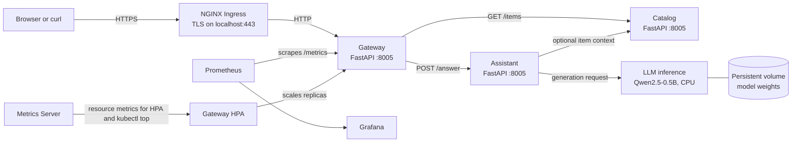

# Architecture

## Components and request flow

The public request path ends at the gateway. `GET /api/v1/items` is forwarded to the catalog. `POST /api/v1/ask` is forwarded to the assistant, which can fetch item context from the catalog and then asks the internal LLM service to generate an answer. The catalog, assistant, and LLM are `ClusterIP` services and have no Ingress route.

All application containers listen on port `8005`. NGINX terminates the local TLS connection and sends HTTP to the gateway service. The Ingress host is `llm-app.local`; local Kind host ports are bound to localhost. The Ingress manifest allows `127.0.0.1/32` and the cluster pod CIDR `10.244.0.0/16`. NGINX trusts forwarded client IP headers from the configured Kind Docker bridge gateway address, which is set as a single proxy address in Terraform.

## Model delivery

The model weights stay outside the `llm:v1` image in a PVC mounted under `/model-weights`; the model file is at `/model-weights/data/model.safetensors`. The repository includes a one-time `model-downloader` Job and an LLM Deployment init container that both call `services/llm/download_model.py`. The script uses a pinned Hugging Face revision and checks the configured SHA-256. In the recorded dev deployment, the model Job completed and the LLM deployment became ready. The duplicate download paths are a simplification that should be consolidated to one clear owner before production use.

## Infrastructure and observability

Terraform creates a local Kind cluster, NGINX Ingress, the kube-prometheus-stack chart, and Metrics Server. Prometheus and Grafana are in the `monitoring` namespace. A `ServiceMonitor` scrapes the gateway's `/metrics` endpoint. A `PrometheusRule` defines gateway error-rate and failed-job alerts. Metrics Server is separate from Prometheus: it provides Kubernetes resource metrics for `kubectl top` and the gateway HPA. The dev release returned node and pod resource metrics.

There is no centralized application log backend in this deployment; use `kubectl logs`. Grafana and Prometheus are installed, but alert delivery to an incident channel and alert firing have not been verified. Only the gateway has an application `ServiceMonitor`.

## Namespaces

| Namespace | Main contents |
|---|---|
| `app` | Gateway, catalog, assistant, LLM, model Job, PVC, CronJob, app policies and alert scrape configuration |
| `ingress-nginx` | NGINX Ingress Controller |
| `monitoring` | Prometheus, Grafana, Alertmanager components from the chart, and the PrometheusRule |
| `kube-system` | Kind system components and Metrics Server |

The `app` namespace enforces the Kubernetes restricted Pod Security Standard. Application pods use dedicated ServiceAccounts with token automount disabled. NetworkPolicy manifests provide default-deny and explicit allow rules, but enforcement by the active CNI was not proven with a negative pod-to-pod connectivity test during the assessment run.

## Environment note

Terraform uses separate roots in `infra/terraform/environments/dev` and `infra/terraform/environments/prod`. Each root calls the shared `infra/terraform/modules/platform` module and stores its local state in its own directory. The Makefile selects the root with `ENV`. Only `dev` was deployed and tested; `prod` is an isolated but unverified assignment configuration.
