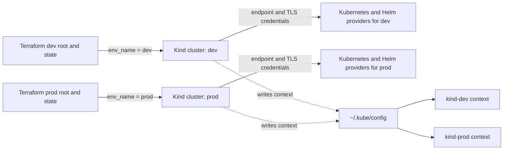

# Terraform, Kind, and kubeconfig: how the connection works

This note explains how the assignment connects Terraform to two local Kind clusters, why `kind-dev` appeared to be missing, and why destroy uses a different provider configuration from create.

## The names refer to different things

There are three related names in play:

| Name | Example | What it identifies |
|---|---|---|
| Kind cluster name | `dev` | The Docker-backed Kubernetes cluster managed by Kind and Terraform |
| kubectl context | `kind-dev` | A named connection profile in kubeconfig; it selects a cluster and credentials |
| Terraform state root | `infra/terraform/environments/dev` | The directory whose local state records the Terraform-managed dev resources |

`kind get clusters` lists cluster names, so it prints `dev` and `prod`. `kubectl config get-contexts` lists contexts, so it prints `kind-dev` and `kind-prod`. The `kind-` prefix belongs to the context name; it is not part of the cluster name. Kind normally creates a context named `kind-<cluster-name>`.

## What kubeconfig contains

Kubeconfig is a client-side connection file. It is not the cluster itself and it is not Terraform state. A kubeconfig can hold several clusters, users, and contexts:

- **Cluster entry:** Kubernetes API server address and certificate authority.
- **User entry:** credentials for the client. For these Kind clusters, that is normally a client certificate and private key.
- **Context:** a pairing of one cluster entry and one user entry, optionally with a default namespace.
- **Current context:** kubectl's default choice when a command does not specify `--context`.

The normal file on this Mac is `~/.kube/config`. It can contain both `kind-dev` and `kind-prod`. Selecting a current context changes the default for kubectl; it does not start, stop, create, or delete either cluster. Commands such as `kubectl --context kind-dev ...` choose dev explicitly and ignore the current-context selection.

The context name also does not prove that the cluster is alive. A kubeconfig context can remain after its Docker cluster has been deleted. Check the actual Kind clusters with `kind get clusters`; then check API reachability with `kubectl --context kind-dev get nodes`.

## Who does what during apply

This repository has three Terraform providers, each with a different job:

1. The **Kind provider** manages the local cluster resource `kind_cluster.main`. Its `name` is `var.env_name`, so the dev root creates cluster `dev` and the prod root creates cluster `prod`. Kind makes credentials and a context available through kubeconfig. The Kind provider also exports the API endpoint, client certificate, client key, and CA certificate as resource attributes.
2. The **Kubernetes provider** creates namespaces and other Kubernetes API resources.
3. The **Helm provider** installs charts, including ingress and monitoring.

During normal Terraform operations, `destroying_kind` is false. In [the provider configuration](../../infra/terraform/modules/platform/providers.tf), the Kubernetes and Helm providers receive the endpoint and client TLS credentials from `kind_cluster.main`. Terraform resources that use those providers also declare a dependency on the cluster, so the cluster is created before Terraform tries to create namespaces or Helm releases.

The dev and prod roots select different values for `env_name`, host ports, and other settings. They have separate local state because Terraform is run from a different working directory for each environment. Their kubeconfig is still shared: it is a common client file containing contexts for both clusters.



## Why destroy uses a kubeconfig path

The `destroy` target in the root Makefile runs Terraform from the selected environment root and passes `destroying_kind=true`. That flag changes both provider configurations:

- Terraform stops supplying the endpoint and certificate fields from `kind_cluster.main`.
- Terraform instead reads `pathexpand("~/.kube/config")` and explicitly selects `kind-${var.env_name}`.

That branch is a lifecycle workaround in this single-root design. The Kubernetes and Helm providers need a working connection while Terraform removes the Helm releases and Kubernetes objects, before Kind removes the cluster. The destroy flag tells them to reconnect through a saved kubeconfig context for that teardown. It is not a separate username/password login; the kubeconfig supplies the cluster address and client certificate credentials.

There are two different operations involved in a full destroy. Helm and Kubernetes resources must be removed while the API server still exists. The Kind provider then removes the cluster. Terraform uses the state graph and the declared dependencies to order those operations.

## Why the `kind-dev` error happened

The dev root previously constructed this path:

```hcl
kubeconfig_path = "${path.root}/../../dev-config"
```

Here `path.root` is `infra/terraform/environments/dev`, so that expression resolves to `infra/terraform/dev-config`. That file did not contain the `kind-dev` context. The normal kubeconfig did contain it, and a separate environment-local kubeconfig also existed, but Terraform was reading the wrong file. The destroy provider therefore could not select the requested context and reported that `kind-dev` did not exist.

The shared module now calls `pathexpand("~/.kube/config")` directly in both provider configurations, so the environment roots do not need to know or pass the shared file path. `pathexpand` turns `~` into the user's home directory; Terraform does not automatically expand a tilde in every provider path. The module still chooses the environment-specific context explicitly, so the current kubectl context does not redirect a prod destroy to dev.

When this failure was inspected, the evidence was:

- `kind get clusters` listed `dev`.
- `kubectl --context kind-dev get nodes` reached `dev-control-plane`, which was Ready.
- The dev Terraform state still tracked `module.platform.kind_cluster.main` and its dependent resources.
- The saved kubeconfig at the old path had no contexts, while the normal kubeconfig had `kind-dev` and `kind-prod`.

That means the error was a **client configuration path problem**, not proof that the Kind cluster was gone. If a cluster is genuinely gone, `kind get clusters` will not list its cluster name and the context may still remain stale in kubeconfig.

## Useful commands

```bash
# Actual Kind cluster names: dev, prod
kind get clusters

# Contexts in the default kubeconfig and which one kubectl uses by default
kubectl config get-contexts
kubectl config current-context

# Reach each cluster explicitly, regardless of current-context
kubectl --context kind-dev get nodes
kubectl --context kind-prod get nodes

# Look at the applications in each cluster; app workloads are in namespace app
kubectl --context kind-dev get pods -n app
kubectl --context kind-prod get pods -n app

# Terraform state is scoped to the chosen root directory
terraform -chdir=infra/terraform/environments/dev state list
terraform -chdir=infra/terraform/environments/prod state list
```

The Makefile's `make destroy ENV=dev` intentionally deletes the dev resources and cluster tracked by dev state. Do not run it merely to switch kubectl to dev; use `kubectl --context kind-dev ...` instead. Likewise, `make destroy ENV=prod` acts on prod's independent state.

## Trade-offs and a cleaner future design

The current setup is understandable for a small local assignment, but it has a few moving parts:

- One module contains the Kind resource as well as Kubernetes and Helm resources.
- Provider setup has a conditional branch for apply versus destroy.
- Both environments rely on the same user-level kubeconfig file, with different explicit context names.
- Kubeconfig credentials and Kubernetes client credentials are sensitive. Terraform state may also contain provider outputs or credentials; keep both state and kubeconfig out of source control.

Terraform provider configurations generally need values that are known before Terraform starts applying resources. The current provider blocks refer to connection details exported by a resource that creates the cluster. That couples provider startup to resource creation and is a known rough edge. HashiCorp recommends keeping provider configurations in the root module and passing configured providers to child modules. A more robust bootstrap design would use two Terraform stages: first create the Kind cluster; then, in a separate root/state, configure Kubernetes and Helm providers from the generated kubeconfig and install cluster resources. Destroy would reverse those stages: remove Kubernetes/Helm objects first, then destroy the Kind cluster.

That two-stage layout removes the apply/destroy credential switch, but adds an explicit second init/plan/apply phase and another state boundary. For this assignment, the corrected kubeconfig path is the smallest fix; the two-stage split is a worthwhile cleanup if this grows beyond a laptop demo.

## References

- [Kind provider cluster resource](https://registry.terraform.io/providers/tehcyx/kind/0.5.1/docs/resources/cluster) — cluster name, kubeconfig path, endpoint, and client credentials.
- [Kubernetes provider configuration](https://registry.terraform.io/providers/hashicorp/kubernetes/2.31.0/docs) — config path and explicit context selection.
- [Terraform provider configuration](https://developer.hashicorp.com/terraform/language/block/provider) — provider configurations must use values Terraform knows before apply.
- [Provider configurations in modules](https://developer.hashicorp.com/terraform/language/modules/develop/providers) — provider lifecycle and root-module guidance.
