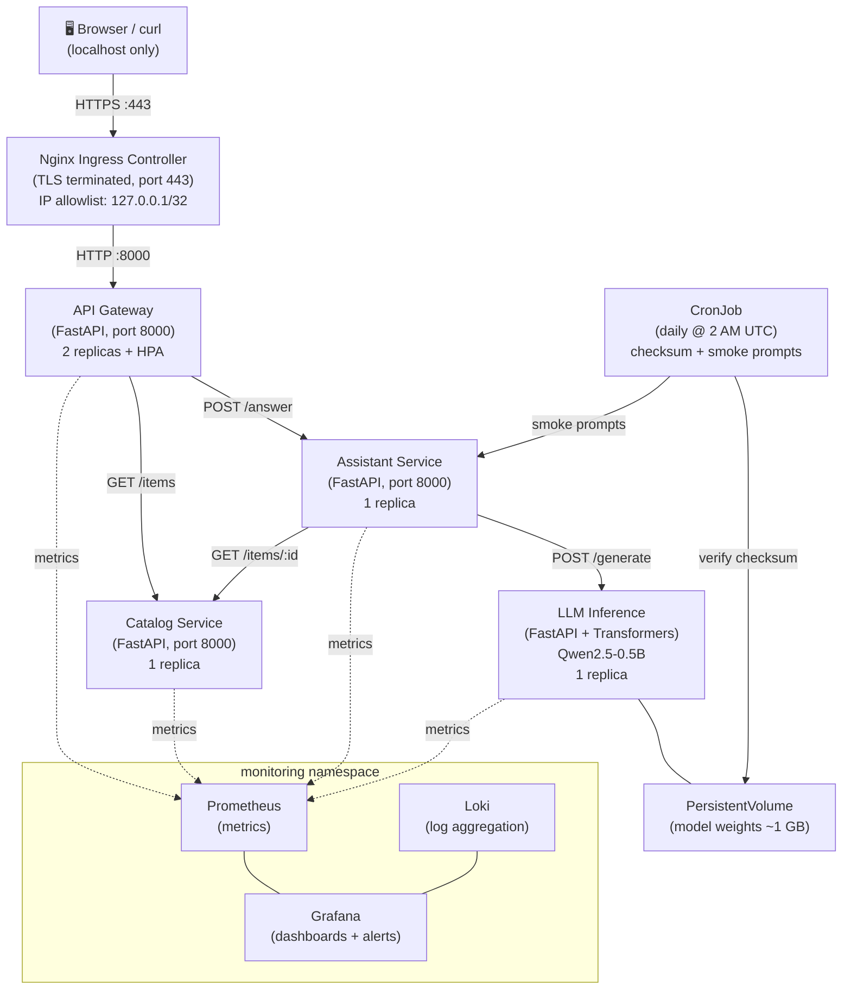

# Architecture

## Component Diagram



## Data Flow for POST /api/v1/ask

```
curl → Ingress (TLS) → Gateway → Assistant → Catalog (if item_id given)
                                           → LLM → Answer
                                Gateway ← Assistant
curl ← Ingress ← Gateway
```

## Namespaces

| Namespace | Contents |
|-----------|----------|
| `app` | gateway, catalog, assistant, llm, CronJob |
| `ingress-nginx` | Nginx Ingress Controller |
| `monitoring` | Prometheus, Grafana, Loki |

## Security Boundaries

- Only the gateway is reachable from outside the cluster (via Ingress)
- Catalog, assistant, and LLM services are `ClusterIP` — no external exposure
- NetworkPolicies enforce default-deny; only explicit allow rules work
- All pods run as non-root with read-only root filesystems
